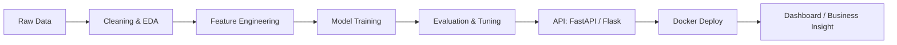

 

---

## 👋 About Me

I'm a data science practitioner from **Coimbatore, India**, with an **M.Com (Computer Applications)** and an **Advanced Data Science programme (Learnbay, IBM-certified)**.
I turn messy business data into models people can actually use, and I like shipping the full pipeline: **cleaning → modelling → evaluation → API → dashboard → Docker**.

- 🔭 Building end-to-end ML projects with a focus on business impact
- 🌱 Currently deepening: **Python, SQL, ML fundamentals, Docker, MLOps basics**
- 🎓 Planning a master's in **Data Science / Analytics**
- 🎾 ITF-certified tennis coach: discipline, patience and consistency carry over to training models
- 📫 Reach me: **mdnawfal69@gmail.com**

---

## 🛠️ Tech Stack

**Languages & Databases**

**Data & Machine Learning**

**Deployment, Tools & BI**

---

## 🚀 Featured Projects

<table>
<tr>
<td width="50%" valign="top">

### 📉 Telecom Customer Churn Prediction
ML pipeline to predict churn, tuned for **high recall (80%)** using **SMOTE + Logistic Regression**, with a business value impact analysis.

`Python` `scikit-learn` `SMOTE` `Pandas`

[🔗 View Repo](https://github.com/Mohamed-Nawfal/Telecom-Customer-Churn-Prediction)

</td>
<td width="50%" valign="top">

### 🛒 E-commerce Recommendation System
Hybrid recommender using **SVD + cosine similarity**, served through a **FastAPI** microservice for real-time inference, plus an interactive **Power BI** dashboard.

`Python` `SVD` `FastAPI` `Power BI`

[🔗 View Repo](https://github.com/Mohamed-Nawfal/Ecommerce-Recommendation-System-Capstone-Project)

</td>
</tr>
<tr>
<td width="50%" valign="top">

### 📦 Supply Chain Demand Forecasting
End-to-end forecasting pipeline: data engineering, model optimization and a **containerized Flask API deployed with Docker** for real-time predictions.

`Python` `Forecasting` `Flask` `Docker`

[🔗 View Repo](https://github.com/Mohamed-Nawfal/End-to-End-supply-chain-Demand-forecasting-with-Docker)

</td>
<td width="50%" valign="top">

### 🧪 Machine Learning Hands-On
Notebooks where I practise core ML algorithms, feature engineering and model evaluation from scratch.

`Python` `Jupyter` `scikit-learn`

[🔗 View Repo](https://github.com/Mohamed-Nawfal/Machine-Learning-Hands-On)

</td>
</tr>
</table>

---

## 🔄 My ML Workflow

---

## 📊 GitHub Stats

---

## 🎯 Currently Working Toward

| Goal | Status |
|---|---|
| Strengthen Python + SQL fundamentals | 🔄 In progress |
| Build 1 new ML project every month | 🔄 In progress |
| Learn Docker and MLOps more deeper | 🔄 In progress |
| Master's in Data Science / Analytics | 🎓 Planned (jan 2027) |

---

## 🤝 Let's Connect

I'm open to **Data Science, Data Analyst and ML roles**, internships and collaborations.

📧 **mdnawfal69@gmail.com** &nbsp;|&nbsp; 💼 [LinkedIn](https://www.linkedin.com/in/mohamednawfal0000) &nbsp;|&nbsp; 📸 [Instagram](https://www.instagram.com/_nawfal____)

 

